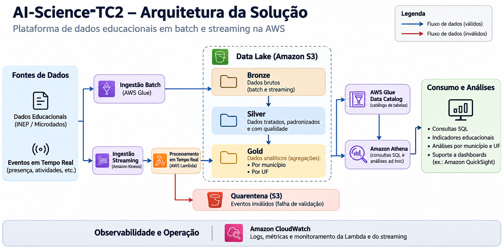
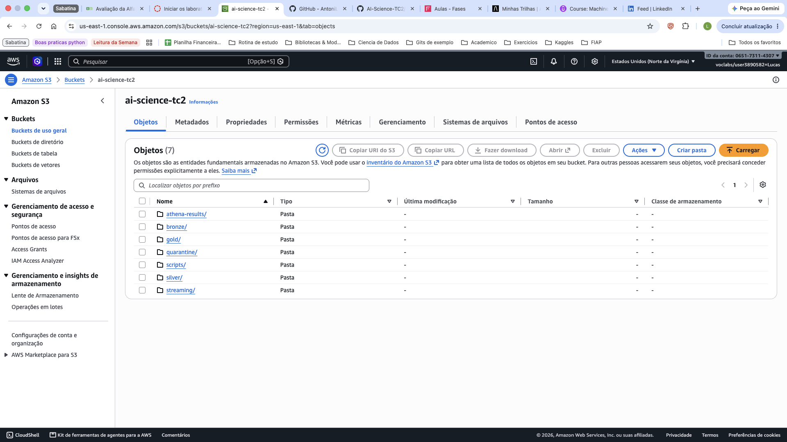
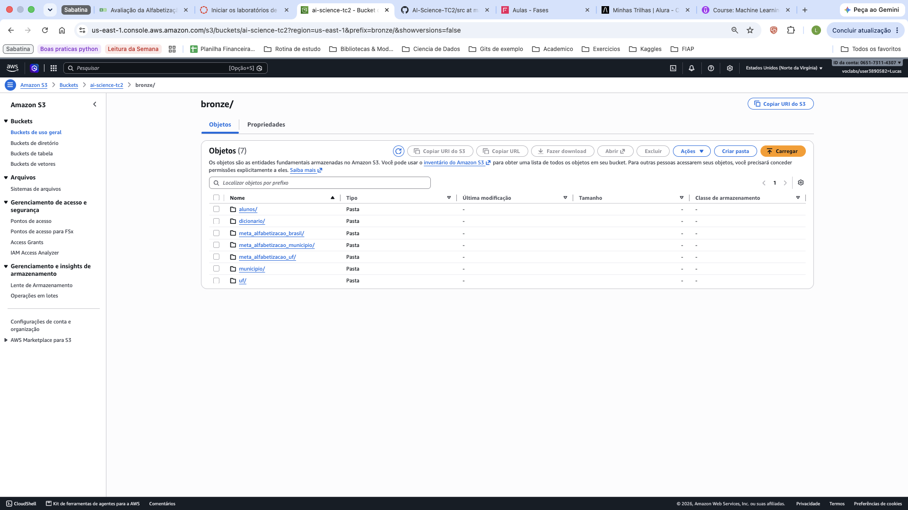
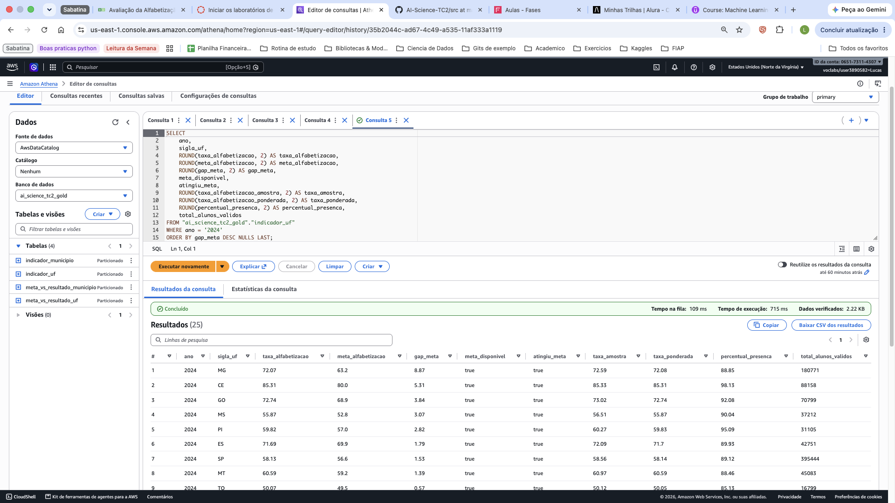
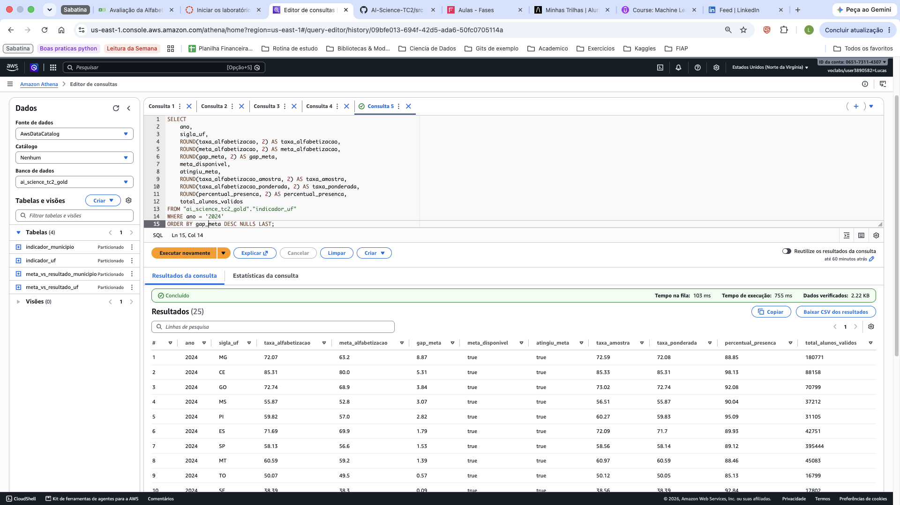
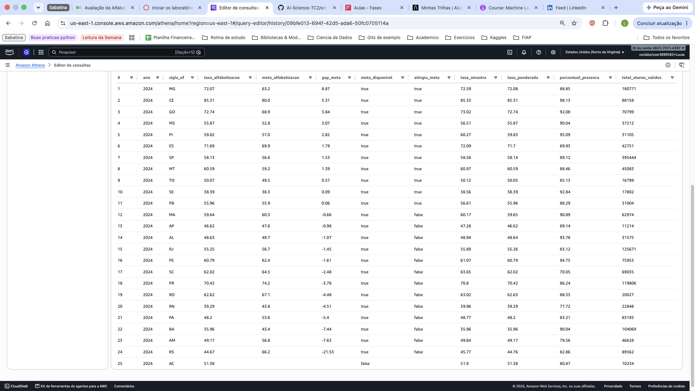
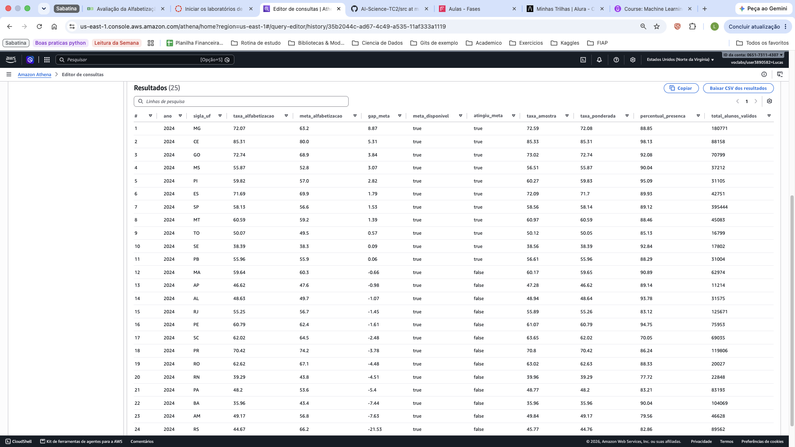
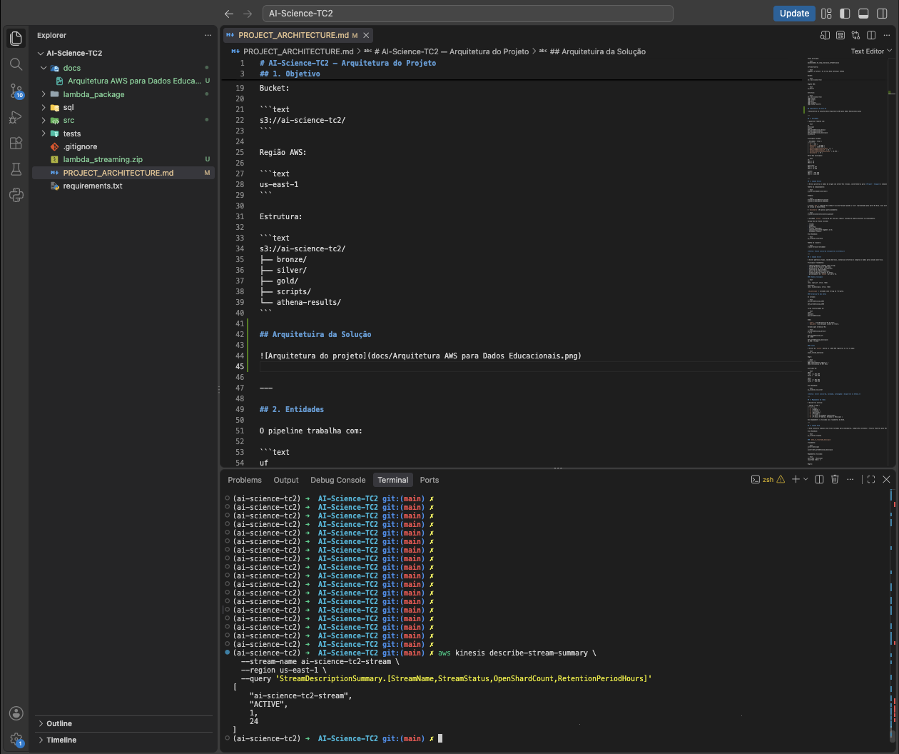
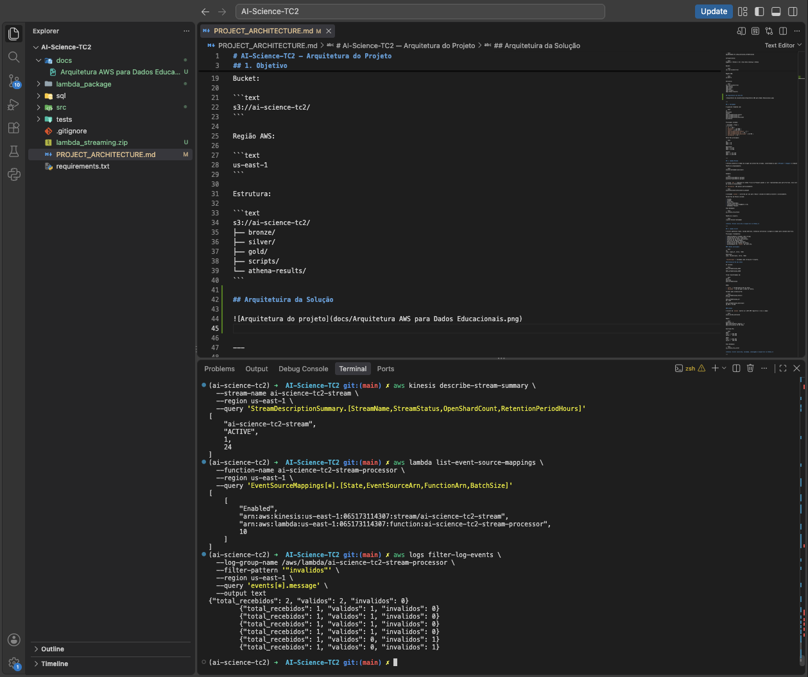
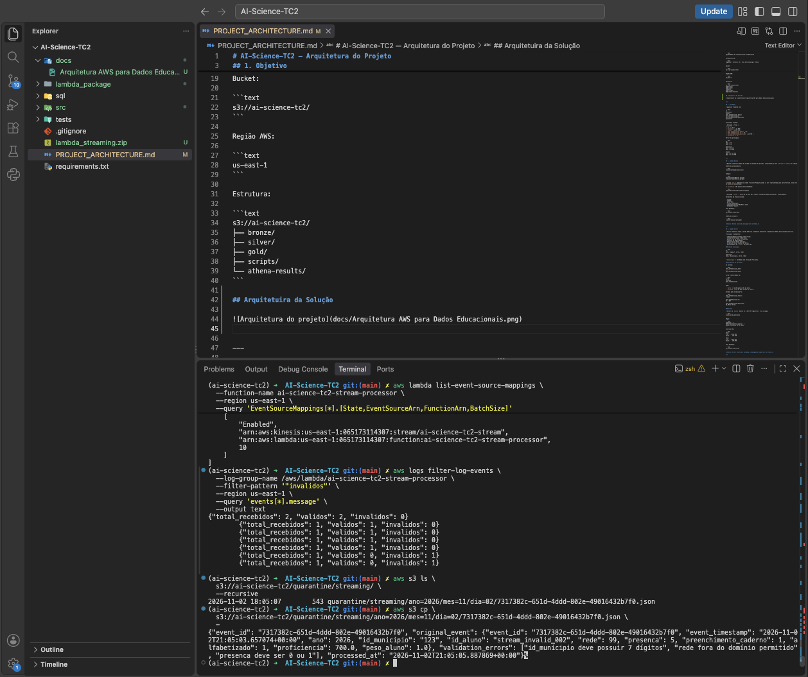

# AI-Science-TC2 — Plataforma de dados educacionais

Entrega final do Tech Challenge FIAP: Data Lake de alfabetização com pipeline batch, camada analítica e demonstração de streaming na AWS.

**Status: entrega concluída no escopo documentado**, com Bronze, Silver, quatro tabelas Gold, catálogo para consultas no Athena e fluxo Kinesis → Lambda → S3 com validação, quarentena e logs. As evidências registram a execução no ambiente de laboratório em 02/11/2026; não representam monitoramento contínuo dos recursos.

## Objetivo

Organizar dados públicos de avaliação da alfabetização em camadas Bronze, Silver e Gold para comparar resultados e metas por município e UF, calcular indicadores e permitir consultas SQL. Complementar o processamento histórico com eventos simulados de alunos, separando eventos válidos e inválidos.

## Arquitetura

```text
Batch:     BigQuery → Python/Pandas → S3 Bronze → Silver → Gold
                                           ↓        ↓       ↓
                                      Glue Data Catalog → Athena

Streaming: Python Producer → Kinesis → Lambda → S3 streaming/bronze/ (válidos)
                                         ├──→ S3 quarantine/streaming/ (inválidos)
                                         └──→ CloudWatch Logs
```

Bucket: `s3://ai-science-tc2/` · Região: `us-east-1`.

O [diagrama da solução](docs/evidencias/arquitetura_solucao.png) apresenta a visão de arquitetura. Na implementação deste repositório, extração e transformação batch são scripts Python; o Glue é usado para catalogação por crawlers. O streaming grava JSON em um prefixo próprio, sem integração automática implementada com a Silver/Gold batch. Dashboards e Machine Learning aparecem como possibilidades de consumo, sem entrega comprovada neste escopo.

O [PROJECT_ARCHITECTURE.md](PROJECT_ARCHITECTURE.md) preserva o detalhamento técnico e os volumes registrados durante o desenvolvimento. Seu trecho de próximos passos é histórico: este README consolida o status final das quatro Gold e do streaming.

## Origem dos dados e entidades

Fonte batch: dataset público `basedosdados.br_inep_avaliacao_alfabetizacao`, consultado no BigQuery pelo cliente Python. Os dados são de avaliação educacional do INEP, disponibilizados pela Base dos Dados. A extração utiliza o projeto GCP configurado em `src/ingestion/extract_batch.py` para executar as consultas.

| Entidade | Conteúdo | Volume registrado na arquitetura |
|---|---|---:|
| `uf` | Resultados por UF, ano, série e rede | 145 |
| `municipio` | Resultados por município, ano, série e rede | 23.995 |
| `alunos` | Microdados de avaliação | 3.867.999 |
| `meta_alfabetizacao_brasil` | Metas nacionais | 3 |
| `meta_alfabetizacao_uf` | Metas por UF | 81 |
| `meta_alfabetizacao_municipio` | Metas municipais | 10.704 |
| `dicionario` | Domínios e descrição dos códigos | 27 |

Esses volumes são os documentados no projeto, sem nova extração nesta revisão. Os resultados e microdados abrangem 2023 e 2024 no recorte registrado; as colunas de metas incluem 2024 a 2030. As metas futuras não constituem resultados observados. Os eventos do producer são **sintéticos**, independentes da ingestão batch e usam o ano corrente em UTC.

## Pipeline batch: Bronze → Silver → Gold

### Bronze: preservação da origem

`src/ingestion/extract_batch.py` extrai as sete entidades do BigQuery e grava Parquet com compressão Snappy em `bronze/<entidade>/ano=<ano>/`. A coluna `ano` fica no caminho Hive e é retirada do arquivo físico, evitando duplicidade no Glue/Athena. O dicionário é gravado sem partição em `bronze/dicionario/`.

A extração de `alunos` ocorre por ano para reduzir o uso de memória. `validate_bronze.py` reconcilia volumes com a fonte e confere os arquivos e partições. A [evidência da Bronze](docs/evidencias/s3_bronze_entidades.png) mostra os sete prefixos de entidades no S3.

### Silver: padronização e qualidade

Os scripts de `src/transformation/` padronizam tipos e identificadores, verificam domínios, faixas, campos obrigatórios e duplicidades, preservando nulos estruturais.

- `id_municipio`: string com 7 dígitos; identificadores não devem perder zeros à esquerda.
- Chaves dos resultados: `(ano, sigla_uf, serie, rede)` e `(ano, id_municipio, serie, rede)`.
- Metas: formato longo com `safra`, `ano_meta` e `meta_alfabetizacao`. `safra` indica a versão da publicação; `ano_meta`, o ano da meta. O particionamento Silver dessas tabelas é por `safra`.
- A normalização registrada expande metas Brasil de 3 para 21 linhas, UF de 81 para 567 e município de 10.704 para 74.928.
- `aluno_valido_avaliacao = presenca == 1 AND preenchimento_caderno == 1 AND proficiencia IS NOT NULL`. O registro continua na Silver mesmo quando o indicador é falso.
- A arquitetura registra preservação dos 3.867.999 microdados na Silver; nulos não são substituídos artificialmente por zero.

Os validadores de cada entidade e os testes existentes verificam contratos e regras semânticas. As imagens disponíveis mostram Bronze, catálogo Gold e consumo analítico; não há captura individual recuperada para cada transformação Silver.

### Gold final

As quatro saídas são gravadas em `gold/<tabela>/ano=<ano>/`, em Parquet/Snappy, e estão listadas no catálogo mostrado no Athena.

| Tabela | Finalidade e composição |
|---|---|
| `meta_vs_resultado_municipio` | Resultados municipais da rede `3` (Municipal) cruzados com metas municipais |
| `meta_vs_resultado_uf` | Resultados da rede `5` (Pública: Estadual + Municipal) cruzados com metas de UF |
| `indicador_municipio` | Enriquecimento da Gold municipal com microdados da rede `3` |
| `indicador_uf` | Enriquecimento da Gold UF com microdados das redes `2` e `3`, agregados por UF |

As comparações selecionam a safra mais recente disponível até o ano analisado e a meta do respectivo `ano_meta`. Registros sem meta permanecem na base, com `meta_disponivel = false`, `gap_meta` e `atingiu_meta` nulos.

```text
gap_meta = taxa_alfabetizacao - meta_alfabetizacao
atingiu_meta = taxa_alfabetizacao >= meta_alfabetizacao
```

O gap é expresso em pontos percentuais. Os indicadores acrescentam contagens de alunos, presença, cadernos preenchidos, alunos válidos, alfabetizados, proficiência média, taxa amostral e taxa ponderada por `peso_aluno`:

```text
taxa_alfabetizacao_amostra = 100 × alfabetizados válidos / alunos válidos
taxa_alfabetizacao_ponderada = 100 × Σ(alfabetizado × peso_aluno) / Σ(peso_aluno)
```

A taxa ponderada usa alunos válidos com peso disponível. Essas taxas calculadas dos microdados são campos distintos da taxa agregada publicada na fonte. A atribuição de UF aos microdados utiliza o código do município e o mapeamento de `src/utils/geography.py`.

No recorte 2024, a arquitetura registra 5.352 municípios comparados: 2.788 atingiram a meta e 2.564 não atingiram. Para UF, registra 25 UFs: 11 atingiram e 14 não atingiram. A captura de `indicador_uf` mostra 25 linhas e os campos de resultado, meta, gap, taxas e presença. Esses números descrevem o recorte documentado, sem generalização para todo o país.

## Glue Data Catalog e Athena

| Camada | Database |
|---|---|
| Bronze | `ai_science_tc2_bronze` |
| Silver | `ai_science_tc2_silver` |
| Gold | `ai_science_tc2_gold` |

Os crawlers seguem o padrão `crawler-<camada>-<entidade>`, com a role de laboratório `LabRole`. Devem apontar para o prefixo da respectiva tabela e atualizar schema e partições após a escrita. Os resultados das consultas Athena são armazenados em `s3://ai-science-tc2/athena-results/`.

A [consulta evidenciada](docs/evidencias/athena_catalogo_gold_consulta.png) usa a Gold de indicadores por UF. Exemplo equivalente para análise de 2024:

```sql
SELECT ano, sigla_uf,
       ROUND(taxa_alfabetizacao, 2) AS taxa_alfabetizacao,
       ROUND(meta_alfabetizacao, 2) AS meta_alfabetizacao,
       ROUND(gap_meta, 2) AS gap_meta,
       meta_disponivel, atingiu_meta,
       ROUND(taxa_alfabetizacao_amostra, 2) AS taxa_amostra,
       ROUND(taxa_alfabetizacao_ponderada, 2) AS taxa_ponderada,
       ROUND(percentual_presenca, 2) AS percentual_presenca,
       total_alunos_validos
FROM ai_science_tc2_gold.indicador_uf
WHERE ano = '2024'
ORDER BY gap_meta DESC NULLS LAST;
```

Outras consultas para conferência e análise, fornecidas para reprodução sem afirmar nova execução:

```sql
-- Distribuição municipal, separando ausência de meta.
SELECT meta_disponivel, atingiu_meta, COUNT(*) AS municipios
FROM ai_science_tc2_gold.meta_vs_resultado_municipio
WHERE ano = '2024'
GROUP BY meta_disponivel, atingiu_meta;

-- Municípios com maior distância negativa da meta.
SELECT id_municipio, taxa_alfabetizacao, meta_alfabetizacao,
       gap_meta, total_alunos_validos
FROM ai_science_tc2_gold.indicador_municipio
WHERE ano = '2024' AND meta_disponivel = true
ORDER BY gap_meta ASC NULLS LAST
LIMIT 20;
```

Os exemplos usam `ano` como string de partição, conforme a consulta evidenciada. Confira o tipo catalogado caso recrie as tabelas.

## Streaming: Producer → Kinesis → Lambda → S3

`src/streaming/producer.py` envia três eventos sintéticos por execução, com UUID, timestamp UTC, aluno, município, rede e dados de avaliação. A chave de partição do Kinesis é `id_municipio`.

| Recurso | Configuração observada |
|---|---|
| Stream | `ai-science-tc2-stream` |
| Estado | `ACTIVE` |
| Capacidade | 1 shard |
| Retenção | 24 horas |
| Lambda | `ai-science-tc2-stream-processor` |
| Event source mapping | `Enabled`, batch size 10 |
| Válidos | `s3://ai-science-tc2/streaming/bronze/` |
| Inválidos por validação | `s3://ai-science-tc2/quarantine/streaming/` |

A Lambda decodifica Base64, interpreta o JSON e executa `validate_event`. Os arquivos são JSON por evento, particionados em `ano=AAAA/mes=MM/dia=DD/` pela **data de processamento UTC**, e nomeados por `event_id`.

### Validação e quarentena

O contrato verifica presença de `event_id`, `event_timestamp`, `ano`, `id_municipio`, `id_aluno`, `rede`, `presenca`, `preenchimento_caderno` e `alfabetizado`. Confere ID do evento não vazio, timestamp interpretável, ano conversível para inteiro e maior ou igual a 2000, município com 7 dígitos, rede entre 1 e 6 e campos binários com valores 0 ou 1. Proficiência, quando informada, deve ser numérica; peso, quando informado, deve ser numérico e não negativo.

Eventos reprovados nessas regras geram JSON de quarentena com `original_event`, `validation_errors`, `processed_at` e `event_id`. A captura mostra um evento com município `123`, rede `99` e presença `5`, acompanhado dos três erros correspondentes. Ausência de proficiência para um aluno ausente pode ser aceita pelo contrato de eventos; validade do evento e validade do aluno para avaliação têm regras diferentes.

### CloudWatch e observabilidade

O log group `/aws/lambda/ai-science-tc2-stream-processor` recebe mensagens de gravação no S3, falhas de processamento e resumos JSON com `total_recebidos`, `validos` e `invalidos`. As capturas mostram lotes válidos e lotes com eventos inválidos, além da consulta ao objeto em quarentena.

No batch, os scripts imprimem volumes, partições, resultados das validações e cobertura dos indicadores. Não há evidência disponível de alarmes ou painel CloudWatch configurados.

## FinOps

- **Parquet e Snappy no batch:** armazenamento colunar comprimido para reduzir volume e leitura de colunas desnecessárias.
- **Particionamento:** `ano` nas tabelas de resultados/Gold e `safra` nas metas Silver; filtros nas partições permitem pruning no Athena.
- **Consultas seletivas:** projetar somente as colunas necessárias e filtrar o ano, como no SQL evidenciado. A captura registra 2,22 KB verificados nessa consulta específica; não é uma estimativa geral de custo.
- **Processamento por ano:** reduz o pico de memória na ingestão dos microdados, embora as transformações continuem dependentes de memória local.
- **Kinesis com 1 shard:** configuração compatível com a demonstração de baixo volume; não representa dimensionamento validado para produção.

O streaming usa JSON por evento, sem Parquet/Snappy ou compactação de pequenos arquivos nessa etapa. Não foram comprovadas economia monetária ou medições de carga.

## Estrutura do projeto

```text
AI-Science-TC2/
├── README.md
├── PROJECT_ARCHITECTURE.md
├── requirements.txt
├── docs/
│   └── evidencias/                 # Imagens da entrega, sem espaços nos nomes
├── src/
│   ├── ingestion/                 # Extração BigQuery e validação Bronze
│   ├── transformation/            # Construção e validação Silver
│   ├── gold/                      # Quatro builders e validadores Gold
│   ├── streaming/                 # Producer, contrato e handler Lambda
│   └── utils/                     # Mapeamento geográfico
├── tests/                         # Contratos Silver e semântica Gold
├── sql/profiling/                 # Diretório reservado para SQL
├── lambda_package/                # Handler e validação para empacotamento
└── lambda_streaming.zip           # Pacote Lambda existente
```

No S3, os prefixos evidenciados são `bronze/`, `silver/`, `gold/`, `streaming/`, `quarantine/`, `scripts/` e `athena-results/`.

## Como executar

### 1. Preparar o ambiente

Execute a partir da raiz do repositório, com Python 3.10 ou superior, acesso ao BigQuery e permissões AWS para os recursos utilizados.

```bash
python -m venv .venv
source .venv/bin/activate
pip install -r requirements.txt
export AWS_DEFAULT_REGION=us-east-1
```

Configure credenciais Google Application Default Credentials para o BigQuery e um projeto com faturamento/permissão de consulta; ajuste `GCP_PROJECT_ID` no extrator se necessário. Configure as credenciais AWS fora do código. No AWS Academy/Vocareum, carregue conjuntamente `AWS_ACCESS_KEY_ID`, `AWS_SECRET_ACCESS_KEY` e `AWS_SESSION_TOKEN` da sessão ativa. Os nomes de bucket, região e stream estão definidos nos scripts e devem corresponder ao ambiente.

### 2. Executar batch e validações

Os comandos abaixo acessam as nuvens e podem sobrescrever as saídas das partições correspondentes. Execute com as credenciais e recursos preparados.

```bash
# Bronze: extração e reconciliação das sete entidades.
for entidade in uf municipio alunos meta_alfabetizacao_brasil meta_alfabetizacao_uf meta_alfabetizacao_municipio dicionario; do
  python -m src.ingestion.extract_batch "$entidade" || break
  python -m src.ingestion.validate_bronze "$entidade" || break
done

# Silver: transformação e validação.
for entidade in uf municipio alunos meta_brasil meta_uf meta_municipio dicionario; do
  python -m "src.transformation.transform_${entidade}_silver" || break
done
python -m src.transformation.validate_silver uf
python -m src.transformation.validate_silver municipio
for entidade in alunos meta_brasil meta_uf meta_municipio dicionario; do
  python -m "src.transformation.validate_${entidade}_silver" || break
done

# Gold: primeiro comparações, depois enriquecimento com indicadores.
for tabela in meta_vs_resultado_municipio meta_vs_resultado_uf indicador_municipio indicador_uf; do
  python -m "src.gold.build_${tabela}" || break
  python -m "src.gold.validate_${tabela}" || break
done
```

Interrompa a sequência se houver falha de validação. Após a escrita de cada camada, execute os crawlers correspondentes no Glue e confira as partições e tabelas no Athena. Se o ambiente for novo, crie bucket, databases, crawlers e permissões antes do consumo; o repositório não fornece provisionamento completo de infraestrutura.

Testes locais existentes, sem reprocessar o lake:

```bash
python -m unittest discover -s tests
```

### 3. Executar streaming e conferir evidências

Pré-requisitos: stream ativo, Lambda com acesso ao S3 e logs, handler `lambda_handler.lambda_handler` para o pacote em `lambda_package/`, e associação Kinesis → Lambda habilitada. O pacote usa importação local de `validation`; o código em `src/streaming/` usa o caminho do módulo do projeto. Mantenha os dois coerentes ao atualizar ou reempacotar.

```bash
python -m src.streaming.producer

aws kinesis describe-stream-summary   --stream-name ai-science-tc2-stream --region us-east-1   --query 'StreamDescriptionSummary.[StreamName,StreamStatus,OpenShardCount,RetentionPeriodHours]'

aws lambda list-event-source-mappings   --function-name ai-science-tc2-stream-processor --region us-east-1   --query 'EventSourceMappings[*].[State,EventSourceArn,FunctionArn,BatchSize]'

aws logs filter-log-events   --log-group-name /aws/lambda/ai-science-tc2-stream-processor   --filter-pattern '"invalidos"' --region us-east-1   --query 'events[*].message' --output text

aws s3 ls s3://ai-science-tc2/streaming/bronze/ --recursive
aws s3 ls s3://ai-science-tc2/quarantine/streaming/ --recursive
```

O producer padrão envia exemplos válidos. Para reproduzir a quarentena, envie separadamente um evento de teste alterado, por exemplo com município `123`, rede `99` e presença `5`, preservando os demais campos obrigatórios e usando um novo `event_id`.

## Status final, limitações e cobertura

| Etapa | Situação da entrega |
|---|---|
| Bronze e Silver | Concluídas conforme arquitetura e scripts de transformação/validação |
| Gold | Quatro tabelas implementadas e listadas no catálogo evidenciado |
| Athena | Consulta de `indicador_uf` executada e resultados capturados |
| Streaming | Kinesis ativo, integração Lambda habilitada, logs e quarentena demonstrados |

A Gold UF de 2024 contém 25 UFs no recorte público. Conforme a análise registrada em `PROJECT_ARCHITECTURE.md`, DF e RR já não aparecem nesse recorte da Silver: a comparação Silver → Gold não identificou perda dessas UFs no join. A cobertura municipal de 5.352 refere-se ao recorte de comparação registrado, sem equivaler a cobertura integral dos municípios brasileiros.

Ausência de meta, microdados ou peso deve ser interpretada como limitação de cobertura, preservando nulos e os indicadores de disponibilidade. Taxas calculadas dos microdados não substituem automaticamente o indicador oficial. Metas até 2030 não ampliam a série histórica de resultados observados.

O streaming é uma prova funcional com eventos sintéticos. O handler captura exceções de decodificação/processamento e registra erro nos logs; essas exceções não têm persistência garantida em quarentena. Não há mecanismo explícito de idempotência, resposta de falha parcial do lote ou reprocessamento de quarentena. Não foi comprovada atualização automática Silver/Gold a partir dos eventos, operação em produção, teste de carga, dashboard ou modelo de Machine Learning.

A documentação foi consolidada a partir do código, da arquitetura existente e dos anexos recuperados, sem nova execução de serviços AWS/BigQuery. O histórico menciona 17 imagens, mas disponibilizou 10 arquivos nesta revisão; todos os 10 foram preservados abaixo, sem criar evidências para etapas não capturadas.

## Evidências da entrega

### 1. Arquitetura da solução

Visão dos fluxos batch e streaming, camadas, catálogo, consumo e quarentena. A implementação efetiva e os limites do diagrama estão descritos na seção de arquitetura.



### 2. S3: organização do Data Lake

Prefixos Bronze, Silver, Gold, streaming, quarantine, scripts e resultados Athena.



### 3. Bronze: entidades ingeridas

Os sete diretórios de entidades da fonte no prefixo Bronze.



### 4. Catálogo Gold e consulta analítica no Athena

As quatro tabelas Gold aparecem no painel de catálogo. A consulta de `indicador_uf` filtra 2024 e ordena pelo gap da meta.



Captura complementar da consulta concluída, com 25 resultados e estatísticas de leitura.



### 5. Gold: resultados analíticos por UF

Resultados com taxa oficial, meta, gap, disponibilidade da meta, atingimento, taxa amostral, taxa ponderada, presença e alunos válidos.



Captura complementar da mesma análise, com a listagem visível até a linha 24.



### 6. Kinesis: estado, capacidade e retenção

Stream `ACTIVE`, com 1 shard e retenção de 24 horas.



### 7. Integração Lambda e CloudWatch

Event source mapping `Enabled`, batch size 10 e resumos de processamento com eventos válidos e inválidos.



### 8. Quarentena: evento inválido e motivos

Listagem do objeto no S3 e leitura do JSON com evento original, erros de município, rede e presença, e timestamp de processamento. A captura também contém os logs e o vínculo Kinesis → Lambda.


